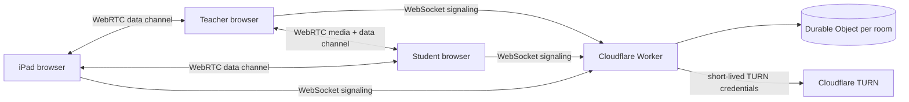

# shiur

A browser-based private tutoring room: live video call plus a shared pen-friendly whiteboard, built for teaching physics and math with an iPad and Apple Pencil.

## What it does

- Direct peer-to-peer video and audio between teacher and student (WebRTC), with automatic recovery after a disconnect or page reload.
- Shared whiteboard tuned for a stylus: pressure-sensitive pen, highlighter, shapes with shape recognition, lasso, partial eraser, disappearing ink, laser pointer, pages, paper templates and axes.
- PDF and image import, PDF export of the whole lesson, Desmos graphing calculator that drops graphs onto the board.
- Teacher-only private pages that are never sent to the student's device.
- An iPad joins as a third device (pen input, no mic or speaker to avoid echo), connected by QR code.
- Screen sharing, chat, lesson timer, connection quality indicator, device picker, optional background blur (MediaPipe, served locally).
- A permanent link per student. Students join from a link with nothing to install.

## Architecture



- `worker/index.ts`: Cloudflare Worker with one Durable Object per room. It only relays call setup messages (signaling) and issues short-lived TURN credentials. Video never passes through the server.
- `src/rtc/`: the WebRTC mesh. Every device connects directly to every other device using the "perfect negotiation" pattern, with ICE restart, a stuck-connection watchdog and epoch numbers for clean rebuilds.
- `src/board/`: the whiteboard. Based on perfect-freehand and pdf.js, synced between devices over an RTCDataChannel and persisted in the browser (IndexedDB).
- `src/ui/`: home screen, lesson screen, toolbar, Desmos dialog.

## Stack

TypeScript, Vite, Cloudflare Workers + Durable Objects, WebRTC, IndexedDB, perfect-freehand, pdf.js, MediaPipe selfie segmentation, Playwright for end-to-end tests.

## Run locally

```
npm install
npm run dev        # http://localhost:8787
```

Optional TURN server (needed when a network blocks direct connections): copy `.env.example` to `.dev.vars` for local use, or set the values as Worker secrets:

```
npx wrangler secret put TURN_KEY_ID
npx wrangler secret put TURN_KEY_API_TOKEN
```

Without them the app falls back to public STUN only.

## Deploy (Cloudflare free tier)

```
npx wrangler login
npm run deploy
```

On Windows, `scripts/deploy-windows.ps1` installs Node and Git if missing, logs in to Cloudflare and deploys in one step.

## Tests

End-to-end tests drive real Chromium instances with fake camera and microphone (teacher, student and iPad in parallel) against a running dev server:

```
npm run test:e2e                 # 27 checks: P2P call, board sync, lock, screen share, reconnect, third device
node tests/features.mjs          # 24 checks on whiteboard tools
node tests/user-session.mjs      # "real user" walkthrough with stylus pressure, palm touches and pinch zoom
```

## Notes

- The Desmos key in `src/ui/desmos.ts` is Desmos' public demo key. For regular use, request a free key at desmos.com/api.

## How it was built

Built by directing AI coding agents (Claude Code); I own the spec, architecture, testing and deployment.
