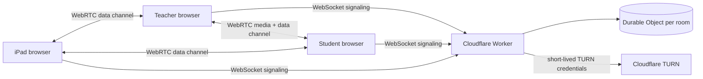

# shiur

A browser-based private tutoring room: live video call plus a shared pen-friendly whiteboard, built for teaching physics and math with an iPad and Apple Pencil.

## What it does

- Direct peer-to-peer video and audio between teacher and student (WebRTC), with automatic recovery after a disconnect or page reload.
- Shared whiteboard tuned for a stylus: pressure-sensitive pen, highlighter, shapes with shape recognition, lasso, partial eraser, disappearing ink, laser pointer, pages, paper templates and axes.
- PDF and image import, PDF export of the whole lesson, Desmos graphing calculator that drops graphs onto the board.
- Teacher-only private pages that are never sent to the student's device.
- Split view: a PDF or image pinned next to the board for teacher and student (synced), with its own scroll and zoom. The iPad stays a pure writing surface.
- One board per lesson: a new lesson never overwrites the previous one, and each lesson is saved as a PDF at the end (see "Lesson PDFs").
- Students start in pointer-only mode (a laser that appears only when they deliberately move the mouse); the teacher allows writing with one tap.
- An iPad joins as a third device (pen input, no mic or speaker to avoid echo), connected by QR code.
- Screen sharing, chat, lesson timer, connection quality indicator, device picker, optional background blur (MediaPipe, served locally).
- A permanent link per student. Students join from a link with nothing to install.

## Architecture



- `worker/index.ts`: Cloudflare Worker with one Durable Object per room. It only relays call setup messages (signaling) and issues short-lived TURN credentials. Video never passes through the server.
- `src/rtc/`: the WebRTC mesh. Every device connects directly to every other device using the "perfect negotiation" pattern, with ICE restart, a stuck-connection watchdog and epoch numbers for clean rebuilds.
- `src/board/`: the whiteboard. Based on perfect-freehand and pdf.js, synced between devices over an RTCDataChannel and persisted in the browser (IndexedDB).
- `src/ui/`: home screen, lesson screen, toolbar, Desmos dialog.

## Stack

TypeScript, Vite, Cloudflare Workers + Durable Objects, WebRTC, IndexedDB, perfect-freehand, pdf.js, MediaPipe selfie segmentation, Playwright for end-to-end tests.

## Run locally

```
npm install
npm run dev        # http://localhost:8787
```

Optional TURN server (needed when a network blocks direct connections): copy `.env.example` to `.dev.vars` for local use, or set the values as Worker secrets:

```
npx wrangler secret put TURN_KEY_ID
npx wrangler secret put TURN_KEY_API_TOKEN
```

Without them the app falls back to public STUN only.

## Deploy (Cloudflare free tier)

```
npx wrangler login
npm run deploy
```

On Windows, `scripts/deploy-windows.ps1` installs Node and Git if missing, logs in to Cloudflare and deploys in one step.

## Lesson PDFs

When the teacher leaves a lesson (or starts a new one, or comes back after a few hours), the lesson's board is rendered to a PDF, without teacher-only pages:

- It is always kept on the teacher's computer (IndexedDB) for 30 days. "Previous lessons" on the home screen lists them with download / share buttons.
- If the Worker has an R2 bucket bound as `LESSONS`, the PDF is also uploaded there and gets a link that can be sent to the student. Files older than `LESSON_KEEP_DAYS` (default 30) are deleted when the list is opened; an R2 lifecycle rule can enforce it too.

Enable cloud storage (R2 needs a payment method on the Cloudflare account; the free tier is 10 GB-month of storage, 1M writes and 10M reads per month, with no egress fees, which a tutoring practice will not exceed):

```
npx wrangler r2 bucket create shiur-lessons
```

Optionally add an "expire after 30 days" rule in the dashboard (R2 → shiur-lessons → Settings → Object lifecycle rules). Then add to `wrangler.jsonc`: `"r2_buckets": [{ "binding": "LESSONS", "bucket_name": "shiur-lessons" }]`, and deploy.

## Tests

End-to-end tests drive real Chromium instances with fake camera and microphone (teacher, student and iPad in parallel) against a running dev server:

```
npm run test:e2e                 # 30 checks: P2P call, board sync, lock, screen share, reconnect, third device
node tests/features.mjs          # 24 checks on whiteboard tools
node tests/user-session.mjs      # "real user" walkthrough with stylus pressure, palm touches, pinch zoom and a PDF worksheet
node tests/lesson-features.mjs   # scrolling, pointer-only students, live ink order, split view, lesson PDFs, blur edges
```

`npm run dev:cloud` starts a second local server (port 8788) with a simulated R2 bucket, so `node tests/lesson-features.mjs http://127.0.0.1:8788` also checks the cloud upload, list and download.

## Notes

- The Desmos key in `src/ui/desmos.ts` is Desmos' public demo key. For regular use, request a free key at desmos.com/api.

## How it was built

Built by directing AI coding agents (Claude Code); I own the spec, architecture, testing and deployment.
